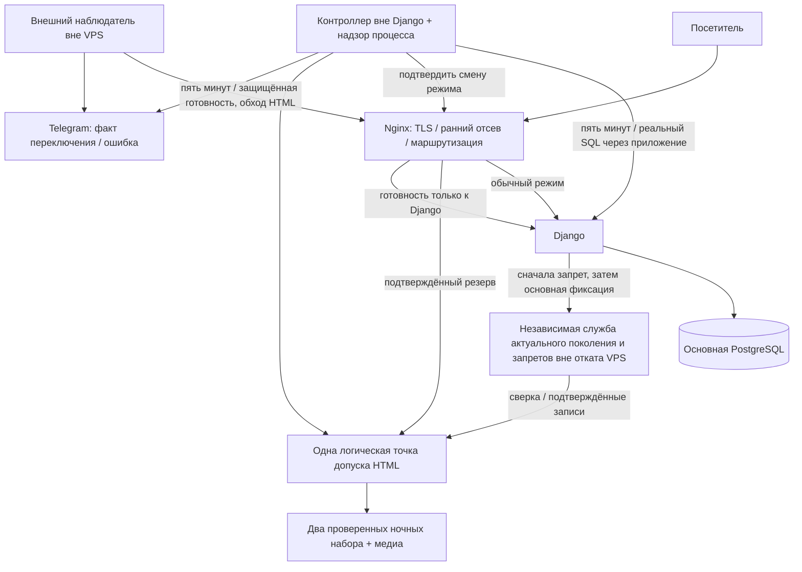

# Схема аварийного режима на согласование — ARC-09

Версия 0.1, 2026-10-30. **Логическая схема согласована владельцем по TEST-Q005 / D-307** после независимого ревью. Конкретное размещение/стоимость/версии/физические примитивы и окончательное ARC-10 ещё не утверждены и не проверены; это не действующая конфигурация. Основа — D-301–D-305, PR-03/04/05/08 и аналитика. Технический проект ниже сохраняет просмотренные формулировки; старый сайт/VPS/БД/ОС/настройки и код нового сайта не меняем.

## 1. Что увидит владелец и посетитель

Когда подтверждённо отказали Django или его БД, живой веб-сервер переключает разрешённые публичные GET/HEAD на ночную HTML-копию. Она выглядит как обычный сайт, без баннера о техническом сбое. Форма не заявляет ложного приёма, предлагает позвонить. В Telegram приходит сообщение только после подтверждения факта переключения. После двух успешных проверок приложение возвращается; копия БД автоматически не восстанавливается.

Если выключен весь VPS/сеть до него/TLS-фронт, HTML на том же VPS недоступен. Внешний наблюдатель сообщает о внешнем отказе; он не утверждает, что включена копия. Второй публичный сервер/автоматический failover DNS не включены в текущий объём. Если допуск старого HTML нельзя подтвердить, возвращается безопасный 503; обещать идентичную полную копию при любом отказе нельзя. Это граница принятого PR-04, не новый срок реакции владельца.

## 2. Рекомендуемое разделение

Nginx — предлагаемый фронт; обычный публичный HTML не получает общий серверный кэш. Наборы не лежат в открытом web-root. **Никакой alias/try_files/error_page не выдаёт их напрямую**, минуя допуск; автоматическая выдача резерва после первой upstream-ошибки не включается. Приватные пути, readiness и POST всегда имеют отдельные правила и не попадают в наборы.

| Компонент | Размещение/обязанность | Что не является его доказательством |
|---|---|---|
| Приложение + основная PostgreSQL | Будущая поддерживаемая среда; база непублична, минимальные роли | Рабочая главная не доказывает целостность всех данных |
| Nginx и HTML gate | Основной будущий хост; gate работает без Django/основной БД | Наличие файла HTML не разрешает его отдавать |
| Контроллер + надзор | Отдельный процесс/учётные полномочия, без импортов Django; bounded независимая исходящая очередь | Один старый heartbeat или рестарт не являются здоровьем |
| Внешний наблюдатель | Вне VPS, проверяет реальную готовность Django/его БД через фронт с обходом резерва | HTML200 не подменяет SQL, доступный Telegram не доказывает переключение |
| Независимый head/журнал запретов | Вне домена восстановления VPS/обычных копий; отдельная административная служба | Это не Яндекс Диск с ZIP, не файл на том же VPS и не только мониторинг |
| Полные копии | 7 внешних / 2 локальных с проверкой/шифрованием по принятому профилю | Это не два HTML-набора и не механизм автоматического restore |

## 3. Конкретный предлагаемый примитив допуска

Для первой небольшой системы предлагается **один активный процесс gate** и одна точка входа к нему. Параллельные nginx workers не читают каждый свой несогласованный whitelist. Запасной gate не стартует активным до исключения старого, получения нового поколения запуска и сверки с независимым head. Для перехода к нескольким активным gate потребуется отдельное доказательство общего fencing/синхронизации; молча масштабировать их копированием процессов нельзя.

Один процесс сериализует короткие операции «разрешить ответ на объект/поколение» и «закрыть допуск». При допуске проверяет точный маршрут/объект/поколение/набор/медиа, открывает неизменяемый файл и закрепляет набор за ответом. Чтение/передача тела происходят после этой короткой границы, без глобальной блокировки на медленном клиенте. Ранее допущенный ответ может завершиться, новый после подтверждённого отзыва не проходит. Удержание набора/медиа и корректный release при разрыве клиента проверяются отдельно.

Предлагается передавать аварийный HTML через сам gate, без X-Accel/direct-file обхода, пока не доказан другой протокол завершения/удержания. Не выдавать память gate за долговечное хранилище: локальное состояние фиксируется целостным durable-файлом, а проверенное актуальное поколение/запрет хранится независимо снаружи. Конкретная реализация fsync/atomic replace/права каталога и тайм-ауты подтверждаются на выбранной среде до кода.

Обычный режим идёт непосредственно от фронта к Django; отказ gate не должен сам по себе ломать исправное приложение. Надзор отдельно сообщает отказ gate/контроллера. В резерве отказ gate закрывает выдачу защищаемого HTML: лёгкий 503 вместо обхода через «последний файл». Это отдельная точка отказа и осознанная цена строгого допуска, а не обещание полной отказоустойчивости хоста.

## 4. Независимый head: конкретная рекомендация и открытое размещение

Предлагается небольшая закрытая управляющая служба с **транзакционной PostgreSQL вне VPS сайта**, уникальными ID операций и упорядоченной записью поколений. Основная БД приложения и эта запись не являются одной транзакцией. Клиентское изменение предлагает ожидаемое поколение; служба под короткой блокировкой одной head-строки проверяет его, добавляет уникальную запись операции/отзыва и новое поколение в одном коммите. Повтор ID возвращает тот же результат; старый writer/старое поколение не перезаписывает более новое. Ответ об успехе выдаётся после долговечной фиксации, не до неё. CAS/row lock — предлагаемый технический выбор, не реализованный API.

Служба не принимает произвольные SQL/файлы/команды и не хранит текст/телефон заявки. Для удаления обращения нужен только непереиспользуемый технический ID/tombstone; это служебные данные с минимальным доступом, не публичный список. Ключи/машинная авторизация вне Git и обычных копий приложения. Это не второй фактор входа владельца. Прямой порт PostgreSQL в интернет не открывается.

Варианты размещения: существующий действительно независимый ресурс владельца, если он есть и отвечает свойствам; отдельная небольшая VM со службой; управляемое внешнее транзакционное хранилище плюс ограниченный API. **Рекомендация на этом шаге — согласовать роль/протокол и изолированную модель проверки; провайдера, расходы и создание ресурса согласовать отдельно.** Бесплатность, SLA и фактическая совместимость ни одного облака не обещаются. Повторно спрашивать, есть ли основной VPS, не нужно.

После старта/restore gate не открывает набор по старому локальному «разрешено». Он проверяет независимую identity/incarnation и актуальное поколение, сравнивает ограничения/receipt/состояние восстанавливаемой БД и закрывает недоказанное. Сам head нельзя восстанавливать старым дампом сайта. Его собственное аварийное восстановление требует отдельного закрытого режима и доказательства актуальности; нельзя объявить старый head свежим только по его подписи/дате. Непроверенная внешняя служба блокирует окончательное ARC-10, даже если владелец одобрит логическую схему.

**На каждом посещении облако не вызывается.** Пока процесс/проверенное состояние непрерывны, решение принимается по локальному актуальному реестру. Сетевые обращения нужны для изменения политики и барьера старта/восстановления/неопределённости. Контроллер/приложение не могут обойти PENDING_DENY или снять запрет по таймеру. Внешняя недоступность не делает старый HTML автоматически безопасным.

## 5. Мониторинг и подтверждение режима

Два независимых пятиминутных источника, по две неудачи/два успеха **внутри каждого**. Параметры readiness сохраняются из аналитики: connect2с / SQL1с / вся внутренняя проверка4с / внешний HTTP6с. Служебная подлинность и лимит проверяются до БД; внутри приложения короткий read-only SELECT его собственной БД. Источник/поколение/номер проверки исключают двойной учёт результата. Ключ не в URL и не в HTML.

Стабильный суточный бюджет — 288 локальных + 288 внешних readiness, **576 HTTP/SELECT в сутки**. Ни скрытого минутного SELECT, ни проверки всех страниц каждые пять минут. Надзор процесса читает heartbeat без SQL. Проверки frontend-маршрутизации при переключении, сверка head, запуск/ручная диагностика и испытания считаются отдельно; цифра576 не выдаётся за весь технический трафик.

| Событие | Действие/наблюдаемое состояние |
|---|---|
| Первая локальная ошибка | Подозрение, без подтверждённого переключения; фактические ошибки приложения не маскируются успешным ответом |
| Вторая последовательная локальная ошибка | Запрос смены только на разрешённый резерв; старый HTML не отдаётся в обход gate |
| Публикация управляющего режима | Только доверенные фиксированные варианты конфигурации, проверка перед загрузкой, ограниченное право на reload; редактор контента не задаёт конфигурацию/команды |
| Проверка результата смены | Служебный запрос через тот же фронт подтверждает выбранный обработчик/поколение и факт доступности gate. Это дополнительный ограниченный HTTP без SQL. Поколение только в файле контроллера не является подтверждением загрузки фронтом |
| Переключение не подтверждено | SWITCH_FAILED/CONTROL_UNKNOWN и отдельное уведомление; не писать «HTML включён» |
| Первый успех после отказа | Резерв остаётся, recovery=1 |
| Второй последовательный успех | Возврат приложения и проверка факта маршрутизации; только после подтверждения сообщение о возврате |
| Повторная ошибка/дубликат проверки | Сброс recovery либо игнорирование дубликата, не новый инцидент на каждую попытку |

Смена маршрутизации Nginx не заменяет согласование отзыва в gate: старые/дренирующие frontend workers всё равно не могут выдавать файлы напрямую. При неудачном reload сохраняется безопасный наблюдаемый старый режим, допускается недоступность; успех не угадывается. Поздний старый callback смены режима проверяет актуальное поколение, не переигрывает более новое решение. Точный протокол подтверждения загруженных workers/handler и атомарная локальная фиксация проверяются на стенде до соответствующего кода; документация Nginx сама по себе его не доказывает.

Внешний источник отвечает за внешний readiness-инцидент/восстановление; локальный — за факт включения/возврата HTML или неудачу переключения. Возможны два разных содержательных сообщения, не дубликат одного на каждый запрос. Отказ Telegram сохраняет ограниченную очередь/состояние вне основной БД и сам наблюдаем; межсервисная exactly-once доставка не обещается. Доказанная компрометация не закрывается по HTTP-успеху.

## 6. Сборка, отзыв, restore

Ночью получается согласованный опубликованный снимок, отдельно строится и проверяется новый набор. Проверяется ограниченный реестр путей/параметров, отсутствие приватного/активных токенов/ложного успеха формы, целостность медиа. Только потом атомарно меняется активный указатель и защита файлов. Хранятся два исправных набора плюс место для временного третьего. Failed не вытесняет исправный; общие/Stable/current-файлы не удаляются с вышедшим набором. Время ночи/ресурсы ещё отдельно согласуются, автоматизация сейчас не создаётся.

Отзыв/переименование: (1) проверить право/основание; (2) durable PENDING_DENY во внешней службе и закрытие локальной точки допуска с подтверждением; (3) повторная проверка и короткий коммит основной БД; (4) финализация HIDDEN/DELETED/REDIRECT/поколения; (5) receipt. Нельзя держать глобальную контентную блокировку во время сетевого ожидания. После задержки сети основание перепроверяется. Pending при ошибке не открывается автоматически.

До коммита — честный отказ и безопасный запрет; после коммита с незавершённой финализацией — «Изменение записано, проверка аварийного доступа не завершена»/ID операции. Неопределённый коммит — «Результат операции пока не подтверждён», проверка **того же ID**, без слепого второго удаления. Восстановление полной копии выполняет владелец вручную; перед открытием восстановленных данных сверяются независимые tombstones/поколения и сессии. При неработающей админке используется отдельная инструкция оператора, а не фиктивная кнопка в недоступном Django.

## 7. Свод правил ответов

| Состояние | Ответ |
|---|---|
| Допустимая опубликованная страница и подходящий ночной набор | Обычный HTML200; без баннера о сбое |
| Главная с прежней публичной ссылкой/ценой удалённого раздела | Ночная главная200 по D-300; автоматической переделки нет |
| Подтверждённо hidden | Пустой белый200 без шапки/контента, запрет индексации |
| Подтверждённо deleted/unknown | Лёгкий404/no-store |
| Новый путь без собственного набора / pending / свежесть неизвестна | Контактный503 на том же URL, без выдуманных контактов/редиректа/чужого HTML |
| Новый URL A→B→C | Оба старых пути301 сразу на C, даже если старый A.html есть. На C — свой набор либо503 |
| Закрытые/admin/history/backup/POST | Не открываются резервом; не превращаются в публичный успешныйGET |
| Readiness | Реальное Django/SQL200 либо503; статика его никогда не подменяет |

Сохраняются отдельные валидаторы/no-cache резерва, no-store503/ошибок и политики301 по принятому контракту. Новый дневной noindex усиливает старый HTML заголовком; обратный index не отменяет ночную meta. Sitemap без доказанной актуальности —503; отказ XML не закрывает допустимую главную.

## 8. Изолированный стенд для будущих тестов

Физически только локальная рабочая среда на T:, без адресов/секретов/данных старого VPS. Логические зоны: APP (будущая Django+основная PostgreSQL), EDGE (фронт/gate/наборы/контроллер), TRUST (независимая служба/head, отдельное хранилище), OBSERVER (внешний взгляд), локальный sink Telegram. Это **модель границ**, не уже созданные контейнеры/compose и не имитация полноценной независимой площадки.

Тестовый rollback APP/EDGE не затрагивает TRUST. Потеря TRUST закрывает недоказанный допуск; возврат старых подписанных APP/EDGE файлов не открывает удалённое. Команды fault принадлежат только локальному управляющему тестов, нет production endpoints. Наблюдаются настоящие HTTP/SQL/поколения/состав файлов/счётчики уведомлений, а не вычисленные expected. Реализация соответствующего инфраструктурного тестового адаптера — после согласования схемы и проверки конкретных примитивов. Код этой системы сейчас отсутствует.

## 9. Проверки, необходимые для ARC-10

| Проверка | Критерий / связи |
|---|---|
| F-01: падают Django и отдельно SQL | Две ошибки своего источника; реальный резерв/факт переключения; AC-045/046, AT-045/046/301/303/305/406 |
| F-02: одна ошибка/успех/retry | Нет двойного учёта/смешения streak; AC-OPS-003/005, AC-PRO-006/007 |
| F-03: медленный допущенный ответ и отзыв | Старый завершается, новый после ack запрещён, файлы удержаны; AC-HTML-003/005, AC-PRO-010 |
| F-04: gate/controller падает на каждой границе | Не обходится допуск, надзор/очередь независимы, нет ложного «переключено»; AC-OPS-005/006, AC-PRO-008 |
| F-05: валидный rollback APP/EDGE | Свежий независимый head отклоняет старое, при неизвестности503; AC-HTML-009, AC-PRO-009 |
| F-06: запрет/коммит/finalize/задержанный callback | Pending не превращается в разрешение, receipt точен; AC-HTML-003/012, AC-PRO-010 |
| F-07: A→B→C, hidden/delete/новый объект | Точные301/пустой200/404/503, нет цепочки/старого200; AC-HTML-011/012, AC-SEO-006 |
| F-08: ночная сборка/нехватка места/старые медиа | Два исправных набора/место третьего/прежние файлы; AC-047, AC-HTML-005/006 |
| F-09: форма без приложения | Нет ложной заявки/цели/отправки полей/постоянного browser storage; AC-048, AC-HTML-008, AC-PRO-012 |
| F-10: ручной restore и удалённая заявка | Tombstone/правила до открытия восстановленной БД, нет автодействия/срока владельца; AC-037/044, AC-DTL-014/020 |
| F-11: весь хост/TLS недоступен | Только внешний сигнал, не ложное включение HTML; AC-OPS-004, AC-PRO-008 |

Это будущие проверки, ни одна не выполнена наличием документа. F-01 не заменяет fault/нагрузку/все AC, а утверждение владельцем схемы не подтверждает внешнего провайдера/физическую независимость/исправность кода.

## 10. Что именно предлагается согласовать

**TEST-Q005:** рекомендованную логическую схему: отдельный от Django контроллер, Nginx с подтверждаемой сменой обработчика, единый gate без прямой выдачи наборов, отдельный независимый head с транзакционным порядком, локальную модель зон и перечисленные отказные результаты. Принятые пять минут/пороги/D-300/ночные копии не переобсуждаются.

Согласование не разрешает установку/изменение VPS, покупку внешнего ресурса, production или код сайта. **Окончательное ARC-10 не закрывается** до независимого ревью, согласования и доказательства конкретной среды/head/примитивов/версий. Нужна отдельная задача выбора внешнего размещения/стоимости до подключения; заявлять бесплатный head нельзя. При отказе от внешнего компонента текущая строгая защита PR-04 не реализуется эквивалентно локальным файлом; это потребовало бы нового явного решения, а не упрощения тестов.

Для будущей ОС предлагается исследовать Ubuntu24.04LTS как базовый совместимый вариант (стандартное сопровождение до мая2029), альтернативно26.04LTS после проверки всего стека. Это **кандидаты**, не выбор/переустановка текущего CentOS7. Подготовка поддерживаемой среды и способ переноса отдельно согласуются после готовности и проверенной копии; пустой веб-каталог не заменяет её.

## Источники технических свойств

Проверены 2026-10-30: [Nginx proxy_pass](https://nginx.org/en/docs/http/ngx_http_proxy_module.html#proxy_pass), [PostgreSQL row-level locking](https://www.postgresql.org/docs/current/explicit-locking.html#LOCKING-ROWS), [Ubuntu lifecycle](https://ubuntu.com/about/release-cycle). Эти источники подтверждают возможности базовых компонентов/сопровождение, **не доказательство всего нашего протокола**. Конкретные версии/зависимости ещё проходят ENV-05 и владельца.
