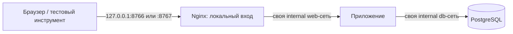

# TEST-Q008: исправление локального HTTP-входа

2026-10-30. **Согласовано TEST-Q008/D-313.** Локальная подготовка и сетевая проверка выполнены: [итог и остаток безопасности](local-foundation-proxy-check.md). Ниже сохранено содержание исходного предложения. Причина: фактическая публикация порта в исходной схеме ARC-11 с единственной internal-сетью не появилась. Доказательства и остальная подготовка — [local-foundation-preparation.md](local-foundation-preparation.md).

## Рекомендованный вариант

Добавить отдельный локальный входной контейнер **Nginx 1.30.6**, официальный образ `nginx:1.30.6-alpine`, с обязательной фиксацией linux/amd64 manifest digest перед скачиванием. [Nginx](https://nginx.org/en/download.html) указывает 1.30.6 как текущую stable. Наличие официального registry manifest проверено read-only; index digest на момент проверки `sha256:0e52bd054126cdc040b1276c0af347aeb02a41b9cfe305d6094767ac30e97949`. Это index digest. После D-313 выбран и получен linux/amd64 manifest `sha256:84ed8c0dd296c188bfc24ed506f46589e9285fb0b11cf3a04d91d524d3067e11`; фактический image ID и результаты записаны в итог проверки.

Для dev и test всё раздельно. У Nginx собственная входная bridge-сеть для loopback-публикации и internal web-сеть. Приложение не подключено к входной bridge-сети; БД не подключена к web-сети. Nginx не видит сеть БД, исходники, пользовательские файлы или её секреты.

Nginx только передаёт запросы фиксированному локальному upstream. Это не открытый forward proxy: без CONNECT, произвольного URL/upstream, Docker socket и доверия к входящим forwarded-заголовкам. Для preflight выдаёт только собственный тестовый маркер, не сайт. HTTP-вход остаётся только 127.0.0.1; TLS/production/старый VPS этим не выбираются.

Начальный лимит нового локального контейнера: **128 MiB RAM, 0.25 CPU, pids 64**. Непривилегированный процесс, cap-drop ALL/no-new-privileges, readonly конфигурация/корень и собственные tmpfs для временных файлов. Для preflight access_log отключён; секреты/заголовки/тело запросов не записываются. Совместимость exact image/UID/readonly и лимитов проверяется реально, не объявляется заранее.

**Граница безопасности:** приложение и БД сохраняют internal/no ordinary internet egress. Сам входной Nginx подключён к обычной bridge-сети и потенциально имеет исходящую сеть; политика no-egress больше не утверждается для всех без исключения runtime-контейнеров. У него нет секретов и бизнес-данных; доступ к приложению ограничен фиксированным upstream, но это не абсолютная защита при компрометации Nginx. Нужны собственная проверка образа/advisory и отрицательные пробы маршрутизации. Этот компромисс выносится на согласование явно.

## Что изменится на компьютере

После разрешения: один дополнительный официальный образ и по одному собственному входному контейнеру/набору сетей на активную dev/test-область, конфигурация инфраструктурного preflight и временные loopback-порты. Всё на T: в существующем Docker, без установки службы Windows, изменений PATH/firewall/hosts и автозагрузки. Приложение и VPS не меняются.

Для этой поправки требовался ответ по AGENTS.md: «Конкретная архитектура, версии и зависимости проходят отдельное согласование». Разрешение D-312 не использовано для молчаливой замены сети/добавления нового инструмента.

## Варианты и вопрос владельцу

**TEST-Q008:** согласовать поправку и разрешить локальную подготовку/проверку Nginx 1.30.6 с новой схемой сетей, без кода сайта и без VPS?

1. **Согласовать и проверить локально — рекомендую.** Появится входной контейнер; приложение и БД сохранят внутренние сети. До успешных проверок схема не считается рабочей.
2. **Отложить.** Сохранить подготовленные артефакты и БД; браузерный вход и допуск к следующей очереди останутся неготовыми. Альтернативную архитектуру потребуется отдельно выбрать.

Этот ответ не означает принятия всех системных advisory и не разрешает код сайта. Разбор безопасности текущих базовых образов остаётся отдельной технической работой в уже разрешённой подготовке.

Ответ TEST-Q008 от 30.10.2026: «Согласовать и проверить локально (рекомендую)», D-313. Установка/проверка выполнены, полного security-pass и разрешения кода нет.
