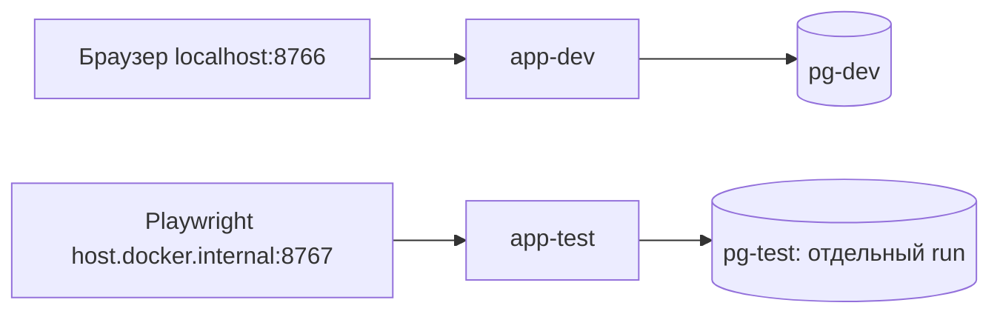

# Единый пакет локальной основы — согласован D-311

**Актуальная поправка D-315:** локальные runtime заменены проверенными сборками из [итога исправлений](base-image-security-remediation.md). В текущем наборе psycopg[c]3.3.6/system libpq17.11, PostgreSQL18.6 без SQL XML/XSLT и минимальный Nginx1.30.6. Ниже сохранена историческая версия соответствующего этапа; источники исходных образов не являются текущим runtime-lock. Код сайта по-прежнему запрещён.

**Поправка D-313: TEST-Q008 принят; локальный вход теперь через отдельный Nginx1.30.6, app/БД host-портов не имеют. Исходная схема ниже историческая в части прямой публикации app.** [Реальные результаты](local-foundation-proxy-check.md). Остаток безопасности не закрыт.

**FOUNDATION-PKG-20261030-01 / TEST-Q007**, версия0.1,2026-10-30. Объединяет ENV-05 приложения, ARC-11 и TEST-12. TEST-Q006 уже принят по D-310. Пакет **согласован TEST-Q007/D-311** ответом владельца «да» 30.10.2026. Позднее D-312 разрешил локальную подготовку; код сайта по-прежнему запрещён. Старый сайт/VPS/ихБД/ОС/файлы/настройки не меняются.

## Коротко для владельца

Рекомендую Python3.14.10 + Django5.2.18LTS + PostgreSQL18.6. Всё запускается в уже существующем LinuxDocker на компьютере, в отдельных контейнерах. Браузер открывает локальный адрес, БД не имеет опубликованного порта. Разработка и автоматические тесты имеют разные БД/секреты/тома; настоящих заявок, интеграций и старого сайта здесь нет.

Первая очередь после отдельного разрешения кода — только DEV-02/DEV-28:воспроизводимая основа/безопасные настройки/миграции и безопасная запись аудита. Пользователи/админка/контент/публичныйперенос/формы/медиа/резервы/аварийныйконтур идут позже со своими пре-кодпроверками и согласованиями. Серверныйхостинг/прокси/TLS/внешнийhead и production этим не выбираются.

## 1. Точные версии и основание выбора

Проверено по первичным источникам30.10.2026, без скачивания пакетов/образов и без установок.

| Компонент | Предложение | Почему / граница свидетельства |
|---|---|---|
| Python | **3.14.10**, обычныйCPython/GIL, Linuxamd64 | Текущий исправленныйрелизветки3.14, выпуск25.10.2026. Ветка вbugfix, окончаниеподдержки запланировано2030-10. Django5.2поддерживает3.14начиная5.2.8. Это документарнаясовместимость, не выполненныйsmoke |
| Django | **5.2.18 LTS** | ПоддерживаемаяLTSветка доапреля2028; текущийpatchветки от06.10.2026. Новейшая6.1.2 поддерживаетсядодекабря2027; еёфункциисейчасне нужны. ОбновлениеподдерживаемойветкидоEOL планируется заранее, неавтоматически |
| PostgreSQL | **18.6** | Текущийminorподдерживаемой18, плановаяподдержкадо14.11.2030; Django5.2допускаетPG14+. PG19RC1 не выбирается |
| DBадаптер | **psycopg[binary]3.3.6**; одноимённыйbinary3.3.6 | Psycopg3рекомендованDjango; PyPI содержитготовоеcp314manylinuxx86_64колесо. Длялокальнойосновы не требуетсякомпилятор. Встроенныеlibpq/OpenSSL обновляются с wheel, не однимaptupdate; их версии/SBOM фиксируются при сборке |
| CSP | **django-csp4.0** | ВDjango5.2нетвстроенногоCSPmiddleware6.x. Выпуск4.0 классифицировандляDjango5.2, добавляетHTTPCSP. Python3.14не указанотдельнымclassifier:совместимость импортом/генерациейзаголовков обязательно проверяется после разрешённойподготовки, не объявляется доказанной по метаданным |
| Linuxобразы | `python:3.14.10-slim-trixie`, `postgres:18.6-trixie` | Эти теги присутствуют в официальномdocker-library/official-images дляamd64. До сборки получить/проверить **manifestdigest** и записать его в lock; никакихплавающихlatest/3.14/18. Сейчасdigestнеполучен и не придуман |

ПакетыDjango/CSP/psycopg — только предложенные прямые зависимости. Все транзитивные зависимости фиксируются точнымиверсиями/SHA256 в воспроизводимомlock после разрешения подготовки, до первого devbuild. Нативныйpip из выбранногоPythonобраза — без глобальногообновленияWindows; его фактическуюверсию тоже записать. Новыхuv/Poetry/Redis/Celery/nginx/Gunicorn/редактора/Pillow на этойочереди не выбираем. CSPиспользуетпакет4.0, не ошибочные дляDjango5.2 `SECURE_CSP`настройки6.x.

Если artifact/import/совместимость/уязвимости не проходят проверку — остановиться с конкретным отчётом, не подменять версии молча и не делатьunsupportedпакет working. Более новый securitypatch проверяется перед реальной подготовкой; изменение предложенногофиксированногонабора документируется и согласуется. Это не обещание отсутствия всех CVE по одной страницеPyPI.

### Первичные источники

- [Python3.14.10, релиз](https://www.python.org/downloads/release/python-31410/), [поддержкаветокPython](https://devguide.python.org/versions/).
- [ПоддерживаемыеDjango/patchиLTS](https://www.djangoproject.com/download/), [PythonсовместимостьDjango5.2](https://docs.djangoproject.com/en/5.2/faq/install/), [5.2.18 securityrelease](https://docs.djangoproject.com/en/5.2/releases/5.2.18/).
- [Django5.2/PostgreSQL/psycopg](https://docs.djangoproject.com/en/5.2/ref/databases/), [PGподдержка/minor](https://www.postgresql.org/support/versioning/), [psycopg3.3.6](https://pypi.org/project/psycopg/3.3.6/), [binary3.3.6/cp314](https://pypi.org/project/psycopg-binary/3.3.6/).
- [django-csp4.0metadata](https://pypi.org/pypi/django-csp/4.0/json):Django5.2classifier, Pythonclassifierдо3.13, requiresDjango>=4.2/packaging. Это не доказательствоruntime3.14.
- [ОфициальныетегиPython](https://raw.githubusercontent.com/docker-library/official-images/master/library/python), [тегиPostgreSQL](https://raw.githubusercontent.com/docker-library/official-images/master/library/postgres), [PG18layout](https://github.com/docker-library/docs/blob/master/postgres/README.md), [Dockerportpublishing](https://docs.docker.com/engine/network/port-publishing/), [Django5.2deploychecklist](https://docs.djangoproject.com/en/5.2/howto/deployment/checklist/).

## 2. Наблюдения до подготовки по D-312

Только read-only запросы:существующий DockerEngine29.9.2/linux/x86_64,Compose5.6.1,14CPU,25151504384байтаRAM≈23,4GiBдоступноVM. НаT:164391227392байта свободно≈153GiB. Это текущие наблюдения, не размерсайта/не ресурсыVPS и не proofпроизводительности. DockerнаT:уже использовался поD-303; обновлениеDocker/WSL/Windows не предлагается. ПинPlaywright1.64.1/pnpm11.25.0/егообраз сохраняется.

На момент согласования пакета новые образы/пакеты **не скачивались**. Компоновкаконтейнеров/доступностьпортов/разрешения/memorylimits/импортDjango/CSP/подключениеPG сейчас не испытывались.

## 3. Локальная схема ARC-11

Два различныхComposeпроекта:dev и test-<runId>; общихБД, сетей, томов или секретов у них нет. Названия принадлежатпроектуnestakada, не совпадаютспрежнимиконтейнерами. Запуск ручной, без автозагрузки/планировщика/измененийfirewall/hosts/DNS.

| Область | Предлагаемая граница |
|---|---|
| Webdev | Публикация только127.0.0.1:8766→app:8000; открывать `http://localhost:8766`. Существующийpreview127.0.0.1:8765не трогать. Runserver допустимтолькоздесь, не вproduction |
| Webtest | Только127.0.0.1:8767→app-test:8000; существующийPlaywrightиспользует `http://host.docker.internal:8767` изконтейнера. Точная достижимостьDockerDesktop проверяетсяpreflight; это ещё не proof. Если loopbackнедостижим — нет автоматическогоперехода на0.0.0.0/реальныйсервер |
| БД | Никаких5432/другихhostports. PGдоступен толькосвоемуapp/migrationjobчерезсвоюизолированнуюdbnetwork; никакихdefaultобщихсетей. Выводпортов проверяется наhostчерезDockerinspect и сетевойпротокол |
| Runtimeсеть | Собственныеinternalnetworks без штатногоинтернетegress; разрешённые app→свойPG и локальныеtestHTTP. Публикацияloopback и достижимостьизтестовогоDocker должны быть подтверждены, флагinternalсампоcебенеproof |
| Артефакты/загрузка | Образы/зависимости получают только отдельнойподготовкой/buildпослесогласования. Во время этойзагрузки нет runtimeсекретов/пользовательскихданных. Runtimeне отправляетTelegram/Метрику/почту и не скачиваетJS/CDN |
| Процессы | App — непривилегированныйUID10001, capdropALL/no-new-privileges, безDockersocket/privileged/hostnetwork/hostPID; исходникиread-only, writableтолькообозначенныеслужебныепапки. Testimage не получает секретыdev/production |
| PGпроцесс | Штатный PostgreSQLserver работаетподсвоимnonrootOSuser. Начальнаяинициализацияvolume у официальногоentrypoint может требоватьroot/chown; она ограничена новымсобственнымтомом, не монтируетworkspace/hostroot. ДействительныеUID/capabilities проверяются; bootstrapне называют«capdropALLуже работает»безиспытания |
| ДанныеPG18 | Собственныйnamedvolume монтируетсяв `/var/lib/postgresql`, PGDATA=`/var/lib/postgresql/18/docker`; не применятьстарый17.xmountкакбудтоонпроверен. Devvolumeсохраняетсяприобычномdown; удаленияс `-v` безявногосогласованногособственногоscopeнет |
| Файлы | Проект/документы/будущие appисходники наT:\nestakada; privatecredentials/buildcache/testevidence внутриигнорируемыхwork/илиtest-results/, неGit. НиC:/профильвладельца/оригиналыфото/живойсайтне монтируются. Dockerданныеиспользуютуже существующееT:хранилище |
| Ресурсыначальногостенда | Предложение:app1CPU/768MiB/pids128,PG1CPU/1GiB/pids128,старыйPlaywright2CPU/2GiB/pids256. Обычнооднаdev/testочередь, безполногонагрузочногопрогона. НачальныйPGmax_connections30/runtimeconnectionlimit10; подтвердитьизмерениями. ПредпусковойзапасT:≥8GiB. Это локальныйтехническийпрофиль, не квотыданных/прогнозVPS/обещаниепроизводительности |

### Cookie/Host и два профиля настроек

TCPпорт не отделяетcookie. Browserdevиспользуетlocalhost,preview127.0.0.1; testbrowserимеетотдельныйcontext и host.docker.internal. Cookiehost-only, безDomain; имена dev/test/production различны. Нельзя считатьименаcookie/разныепорты защитойототправкивсехcookie чужомусервисутогожехоста; проекты не размещаютчужойсервис подэтимhostname. Это доверенныйлокальныйкомпьютер, не обещаниеизоляцииотегоадминистратора.

`local-http`:DEBUG=False как исходныйбезопасныйпрофиль; разрешенытолькоlocalhost/127.0.0.1/host.docker.internal поназначению; USE_X_FORWARDED_HOST=False,SECURE_PROXY_SSL_HEADER=None. SessionHttpOnly/SameSiteLax,CSRFSameSiteLax и CSRFHttpOnly(токендляJSизDOM). Securecookies/HTTPSredirect выключены **толькодляэтоголокальногоHTTP**. НикакогоHSTSнаlocalhost. CSPпервоначальноReport-Only:default-src/self;script-src/self;object-src/none;base-uri/self;frame-ancestors/none;form-action/self, безunsafe-inline/unsafe-eval/внешнихисточников. Это наблюдениеполитики, не доказательствоблокировкибраузером.

`deployment-audit`:отдельныйпрофиль длянепубликуемойпроверкиконфигурации. DEBUG=False,ожидаемыйlogicalHost`estakada.invalid`(ненетворкцель),secure/HttpOnly/SameSitecookies,HTTPSredirect,полнаяCSPвHTTPзаголовках. SECURE_PROXY_SSL_HEADERне доверяетпользовательскомуXForwardedProto безпроверенногопрокси. РеальныйTLS/proxy/domainещёневыбраны, actual HTTPS/edge/CSPexecutionгейтысохраняются. HSTS0 до проверкиTLS/поддоменов;check--deployможетдатьтолькообоснованныйW004какдокументированноенезакрытоеусловие, не«готовностьпродакшена». Никакогоsilenceallwarnings.

Оба профиля failclosed приотсутствииSECRET_KEY/пароляБД, нетdefaultсекрета/SQLitefallback. Тестыотсутствиясекретов выполняютсяфиксированнымдочернимпроцессом безвыводазначений. SQL/HTTPошибки/CLIstderr очищаютсяотсекретов.

### Минимальные права БД

BootstrapDBsuperuser используетсятолькоприначальнойинициализациисобственногокластера/ролей. Appне получаетегоcredentials. `app_migrator` владееттолькосвоейappсхемой, безclusteradmin/CREATEDB/CREATEROLE/REPLICATION/BYPASSRLS; отдельныйодноразовыйmigrationjob используетегоpassword. Runtime`app_runtime` имееттолькоCONNECT/USAGE/нужныеCRUD/sequences; не владеетБД/схемой/таблицами, неCREATE и не можетSETROLEвmigrator/bootstrap. Проверяются membership/ACL/defaultprivileges, не одни флагиpg_roles. ПрямойruntimeDDL должен быть запрещён.

PUBLICнеполучаетсозданиеобъектов/лишниеCONNECTправа. Таблицывсобственнойschemaapp;runtimeбезопасныйsearch_path`pg_catalog,app`,migrationjobявносоздаётвapp. Defaultsдляновыхтаблиц/последовательностей задаютсяmigrator. Бизнесмиграции/схемыданныхне создаютсявэтомпакете.

Секретыdev/test/аудитапрофиляраздельны, генерируютсяпослесогласования, не buildargs/команднаястрока/Git/logs/браузерstorage. Appмонтируетreadonlyтолькосвойruntimepassword/SECRET_KEY; migration/bootstrapсекреты ему недоступны. НаT:права privateпапкипроверяютсяотдельно, не меняютсяглобальныеACL. Настоящихсекретов впримерахнет.

### Проверяемые источники mount и образов

В app монтируется только будущая папка T:\nestakada\app (или отдельный снимок её исходников собственного test-run), не корень репозитория с .git/work/private. Разрешены readonly bind /app и /run/secrets/<name>, tmpfs /tmp и собственный volume /var/lib/estakada. Host-side Docker inspect и канонические пути источников сверяются с заранее проверенным manifest разрешённых mounts: источник socket/host root/profile запрещён независимо от имени target. capAdd должен быть пуст. Поля наблюдения вычисляются по фактическим источникам, не по ожидаемому Compose.

Python-base manifest digest сверяется с фактическим build provenance; manifest PostgreSQL — с разрешённым pull/resolve. Docker config image ID работающего PostgreSQL сверяется с resolved image ID, а app — с built image ID. Manifest digest и config ID не взаимозаменяемы. Для локального app не требуется несуществующий RepoDigest: записываются build record, base material и SHA256 реально использованного dependency lock. Readonly bind исходников проверяется отдельно; image identity не доказывает содержимое такого mount. До подготовки никаких реальных digest/build evidence ещё нет.

## 4. Проверки TEST-12 и порядок после согласования

[foundation-security-checks.md](foundation-security-checks.md) и `acceptance/foundation-security.spec.js`:ограниченный наборпре-кодassertionsпоAT053/055/baseline312 и DEV28redaction. ИспользуютсяреальныеDjango/processsettings,PGroles/privileges и HTTPответы; нетособогопродуктовогоinspectorendpoint/поддельногобизнесдвижка. Недостающийapp/bridgeне превращаетсявpass.

Read-onlyprocessview имеетотдельныйprovenance actual-process,6fixedимён/дваprofile; произвольныекоманды/пути/expectedнеразрешены. Старыеactual-db/http наблюдениянеослаблены. Изоляцияконтейнеров/портов/томовподтверждаетсяещёhost-sideDockerinspect+сетевымпротоколом, не однимboolизпроцесса. До доверенногопрогона concretebindingsпроходятreview.

Последовательность после возможногоодобренияпакета:

1. Отдельноразрешённаяподготовкаинструментов:проверитьсвежестьисточников,зафиксироватьdigest/HASHlock,скачатьпроверенныеартефакты,снятьversion/SBOM/license/уязвимости. Не вводитьдругиеверсиибезотчёта/согласования.
2. ПроверитьPython/Django/psycopg/CSPimport,versionиPGhandshakeвновомизолированномстенде; достижимостьhostloopback/testtarget,границысетей/файлов/томов/ресурсов/секретов. ЭтоENV/ARCpreflight, неэксплуатациясайта. Ошибка — конкретноеусловие, безоткрытияпортавLAN/обходазащит.
3. Послеявногоразрешениякода DEV02/28:создатьfoundation,подключитьнастоящиеtestbindings,прогнатьlocalchecks/configaudit,испытатьсохранениеPGпослепересозданияконтейнерабезудалениятома,проверитьmigration/runtimeразделение.
4. Послеаудитногоwriter DEV28 прогнатьredactionсsyntheticcanaries и защитамиinspectscope; доегонаписаниясценарийготов/отрицательныеусловиянеподменяютсязаглушкой. Фактическийрезультатнезаявлензаранее.
5. Дальше — отдельныйдопускмодулейпо20-rowregister/140AC. НастоящиеCSRFPOST/сессии/аутентификацияпослеDEV03; productionTLS/сканы/полныйCSPбраузером/head/restore/fallbackостаютсясвоимиARC10/READY/TEST08–10гейтами.

Дошага3неразрешённыйкодприложениянепишется. Dockerfiles/Compose/settings/модели/миграции/productionконфиги вэтойподготовкенесоздавались. Реальныебэкапы/cleanupVPS/аккаунты не подключаются.

## 5. Что именно будет изменено при будущей подготовке

В пределахотдельногоразрешения:Linuxобразы/lockиprivateпапкинаT:,новыеименованныеконтейнеры/тома/сети,временные8766/8767локальныепорты. НативныеPython/PGслужбыWindows,PATH,планировщик,firewall/hosts,preview8765,старыйVPS не меняются. Начальныйстендвыключаетсябезфоноработы/автозапуска. Это не выборproductionхостинга и не расходнаоблачныйсервис.

## 6. Состояние согласования

TEST-Q007 согласован D-311 (30.10.2026): версии и проект локальной схемы/11 проверок FOUNDATION приняты. Подготовка документа и независимое ревью завершены. D-312 позднее разрешил подготовку артефактов/preflight; [фактический результат и остаток](local-foundation-preparation.md). Код сайта не разрешён, полного runtime-допуска нет. Старый сайт/VPS не меняются.

TEST-Q007: ответ владельца «да» от 30.10.2026, решение D-311. Утверждены предложенные версии, локальная схема и подготовленные проверки. Совместимость по документам и готовые сценарии не заменяют фактических испытаний. D-310 сохраняет поэтапный порядок и остальные модульные/выпускные ворота.
